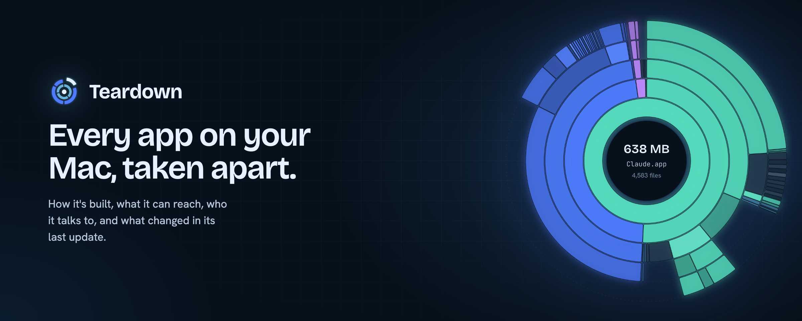
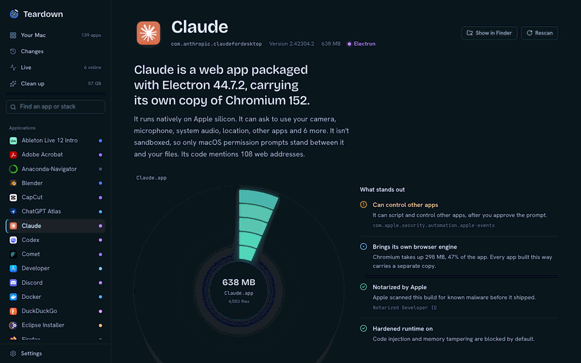
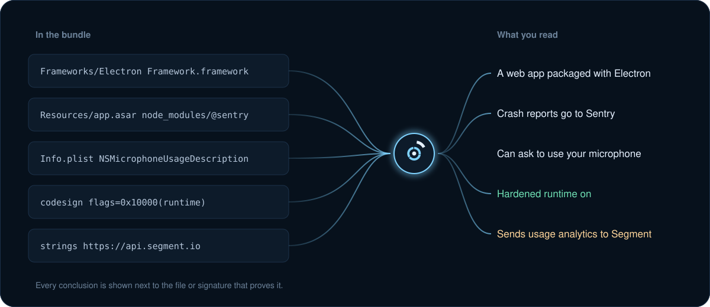

<p align="center">
  
</p>

<p align="center">
  <a href="#look-inside-any-app">Look inside</a>&nbsp;&nbsp;&nbsp;
  <a href="#your-whole-mac">Your Mac</a>&nbsp;&nbsp;&nbsp;
  <a href="#live">Live</a>&nbsp;&nbsp;&nbsp;
  <a href="#changes">Changes</a>&nbsp;&nbsp;&nbsp;
  <a href="#clean-up">Clean up</a>&nbsp;&nbsp;&nbsp;
  <a href="#privacy">Privacy</a>&nbsp;&nbsp;&nbsp;
  <a href="#build-it-yourself">Build it</a>
</p>

<br />

Most of the apps on your Mac are black boxes. You can't tell which ones are a website in a costume, which ones quietly ship three analytics SDKs, which ones can control your other apps, or what changed when one updated itself last night.

Teardown opens them up. It reads every installed app the way a reverse engineer would, then explains what it found in plain English, with the evidence beside every claim. It runs entirely on your Mac, with no account, no analytics and no server.

<p align="center">
  
</p>

On the Mac in these screenshots, Teardown found that **20 of 74 apps are web pages in a wrapper**, carrying **21 separate copies of Chromium** (8.4 GB of them), and that **57 GB** could be freed without losing anything that matters.

<br />

## Look inside any app


Pick an app and Teardown reads its bundle from the outside, without ever launching it. The first thing you see is a sentence, not a table: *Claude is a web app packaged with Electron 44.7.2, carrying its own copy of Chromium 152.*

The ring map shows where every byte goes. Hover to see what a piece is, click to drill in. Next to it, a short list of what actually matters about this app: a permission that loosens macOS's protections, an analytics SDK, a missing notarization, a login item that starts on its own.

Below that, four tabs go as deep as you want:

- **Built with:** the stack and languages, and the exact files that prove it.
- **Permissions:** every privacy prompt the app can show you, quoted in the developer's own words, and every entitlement Apple granted it.
- **Network:** each SDK that phones home, every web address written into the code, and what the app is connected to right now.
- **Inside:** frameworks by size, helper apps and extensions, and for Electron apps, every npm package in the archive.

## How it knows



Nothing is guessed from an app's name or reputation. Teardown looks for concrete evidence, like `Electron Framework.framework`, a Chromium `icudtl.dat`, `FlutterMacOS.framework`, the Swift runtime among the linked libraries, a Go build ID, or the hardened runtime flag in the code signature. Every conclusion in the interface links back to what it found.

## Your whole Mac


The home screen reads everything you've installed, filling in live as it goes, and groups the apps by how they're built. It's the fastest way to see how much of your Mac is native and how much is a browser in disguise.

## Live


Live shows which apps are talking to the internet right now. Teardown resolves the addresses written into each app's code and matches them against its open connections, so you can see at a glance which traffic the app announced and which it didn't. It refreshes every few seconds.

## Changes

Teardown keeps a snapshot of every app. When one updates, it compares the new version with the last and tells you what changed underneath:

- a new analytics or session-recording SDK
- a new request for your camera, microphone, or location
- a different developer signing the app
- a dropped sandbox or a hardened runtime switched off
- Electron and Chromium upgrades, new frameworks, new npm packages, new web addresses

Release notes almost never mention any of that.

## Clean up


Clean up compares what's on disk with what's actually installed and shows the space you can get back:

- **Caches that rebuild themselves**, like npm, Homebrew, Xcode and Simulator caches.
- **Apps you've stopped using**, judged by when each app last touched its own data.
- **Leftovers** from apps you deleted long ago: settings, caches, web data.
- **Broken login items** that point at programs that no longer exist.

Nothing is ever deleted. Teardown moves what you pick to the Trash, so anything can go straight back, and apps that are open are skipped.

## Privacy


Teardown reads files and runs Apple's own command line tools: `codesign`, `spctl`, `otool`, `lipo`, `plutil`, `mdls` and `lsof`. It never launches or modifies the apps it inspects. Everything it keeps lives in `~/Library/Application Support/Teardown`, and Settings has buttons to clear it.

It also audits itself. The Connections section runs Teardown's own engine against its own process and shows that it holds no connections to the internet. You can hide any app from Teardown entirely, and it will leave that app and its data alone on every page.

## Build it yourself

There's no signed download, on purpose. Teardown is meant to be built from source you can read, so you never have to trust a binary from anyone, including me.

You'll need macOS 12 or later on Apple silicon, Node 22, Rust, and the Xcode command line tools.

```sh
git clone https://github.com/AllStreets/teardown.git
cd teardown
npm install
npm run app
```

That builds `Teardown.app` into `src-tauri/target/release/bundle/macos/`. Drag it to Applications. Because you built it yourself, macOS opens it without asking about the developer.

### Or run it in a browser

The same interface works in any browser, no Rust needed:

```sh
npm install
npm run dev
```

Then open http://127.0.0.1:4711. The first pass over every app takes about a minute. After that, only apps that changed are read again.

## How it's put together

| Part | What it does |
| --- | --- |
| `server/analyze.ts` | Reads a bundle: stack, signing, entitlements, privacy prompts, SDKs, web addresses, the size map |
| `server/history.ts` | Snapshots each app and compares versions when it updates |
| `server/network.ts` | Maps open sockets to apps and matches them against each app's code |
| `server/cleanup.ts` | Finds reclaimable space and moves things to the Trash |
| `server/knowledge.ts` | Known SDKs, entitlements and privacy keys |
| `web/` | The React interface; the ring map is SVG laid out with `d3-hierarchy` |
| `src-tauri/` | The Mac app: a small Rust shell that runs the engine beside it and shows the interface in the system WebKit |

The Mac app doesn't ship its own browser engine. Point Teardown at itself and it says so: *Teardown is a web interface running in the Mac's built-in WebKit, with a Rust core underneath.*

## License

MIT. Take it apart.
