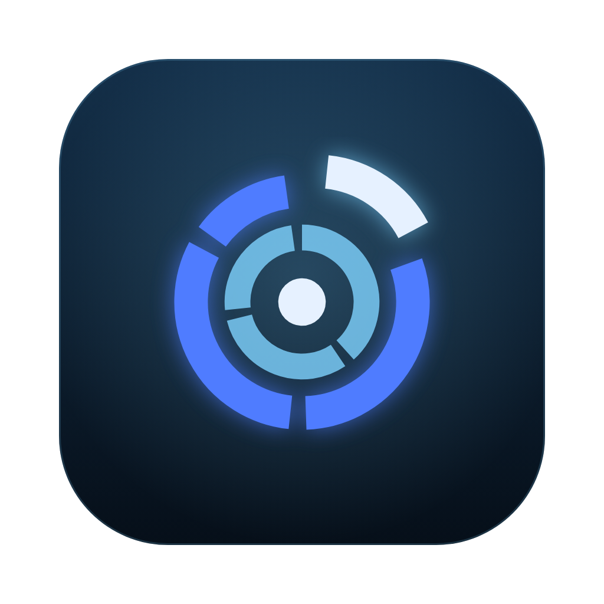
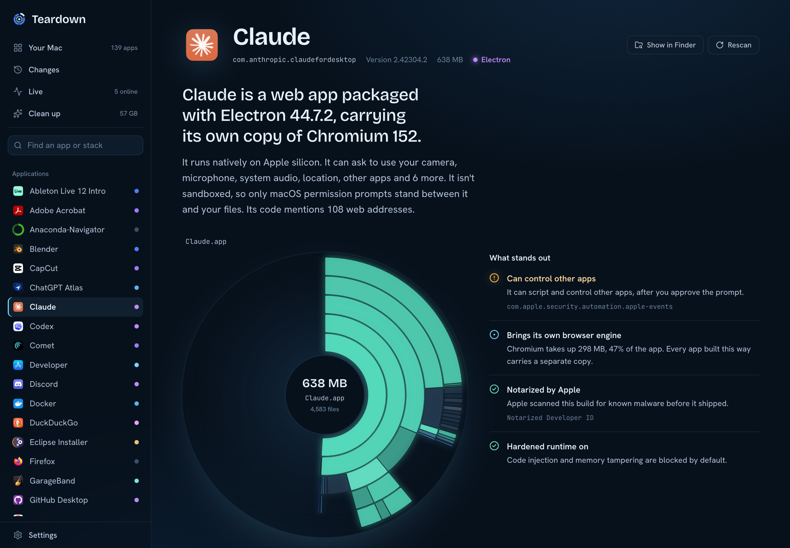
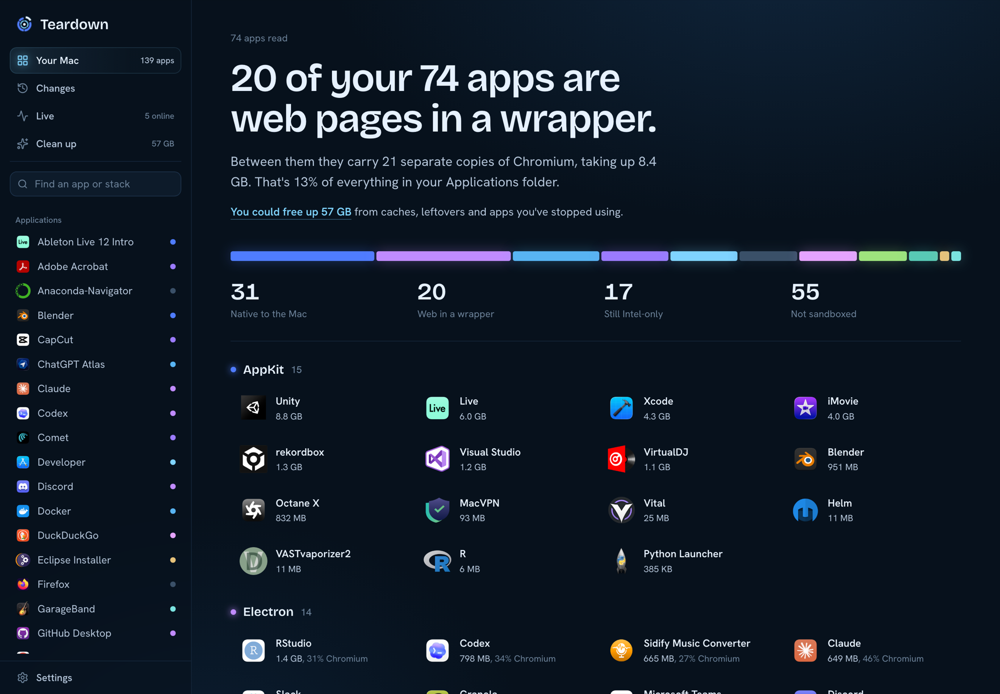
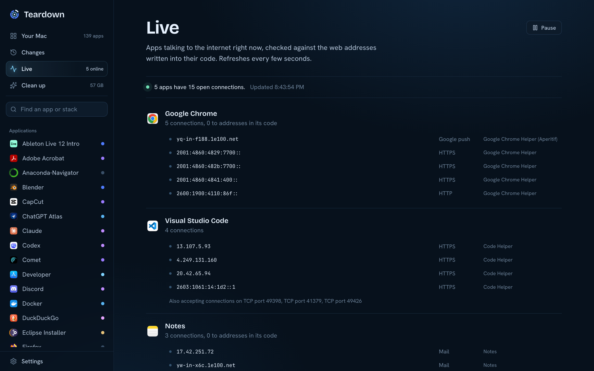
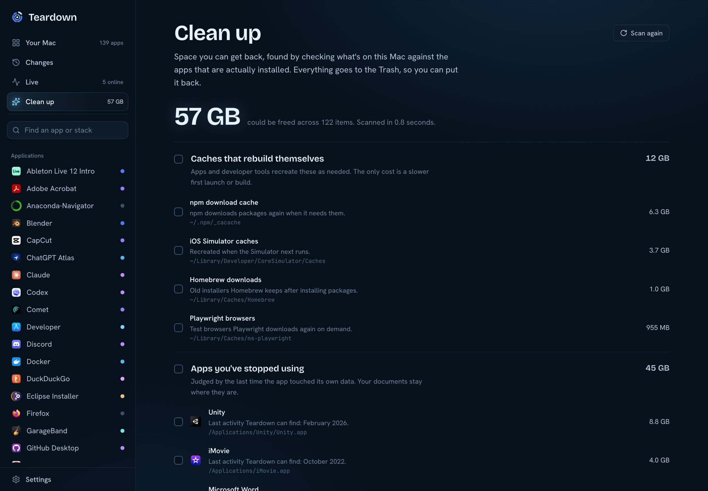
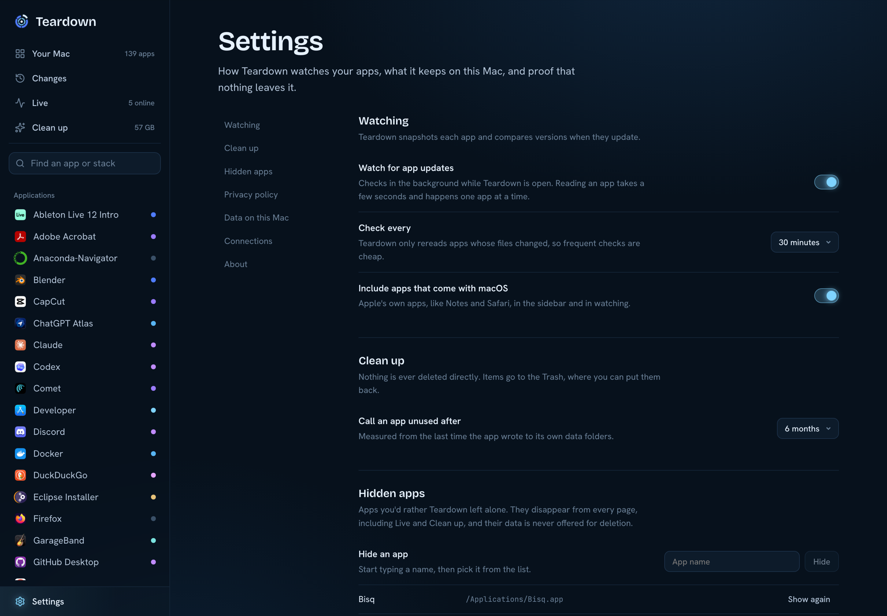

<p align="center">
  
</p>

<h1 align="center">Teardown</h1>

<p align="center">
  See what the apps on your Mac are really made of, what they connect to, what changed in their last update, and what they left behind.
</p>

<p align="center">
  
</p>

Teardown reads the apps installed on your Mac the way a reverse engineer would, and explains them in plain English. Open any app and it tells you how it's built, who signed it, what it's allowed to do, which tracking SDKs it ships, and every web address written into its code. Then it keeps watching: when an app updates, Teardown shows you what changed underneath, and when you want space back, it shows you exactly where it went.

It runs entirely on your Mac. No account, no analytics, no server.

## Look inside any app

Pick an app and Teardown opens up its bundle. The radial map shows where every byte goes, and you can click into any ring to drill down. Next to it is a short list of what actually matters: a permission that loosens macOS's protections, an analytics SDK, a missing notarization.

Every conclusion comes with its evidence. If Teardown says an app is built on Electron, it shows you the framework file that proves it. Electron apps get their `app.asar` archive parsed, so you can see every npm package inside.

## Your whole Mac at a glance



Teardown reads every app you've installed and groups them by how they're built. On the Mac these screenshots came from, 22 of 79 apps turned out to be websites in a wrapper, carrying 23 separate copies of Chromium between them.

## Live connections



The Live page shows which apps are talking to the internet right now, and checks each connection against the addresses written into that app's code. A connection to a server the app never mentions stands out.

## Changes between versions

Teardown keeps a snapshot of every app. When one updates, it compares the new version with the last one and tells you what changed underneath: a new analytics SDK, a new request for your microphone, a different developer signing it, a dropped sandbox. Release notes rarely mention any of that.

## Clean up



Teardown compares what's on disk with what's actually installed and finds the space you can get back: developer caches that rebuild themselves, apps you haven't touched in months, data left behind by apps you deleted, and login items that point at programs that no longer exist. Pick what you want gone and it moves it to the Trash, so you can put anything back.

## Privacy



Teardown reads files and runs Apple's own command line tools (`codesign`, `otool`, `lipo`, `plutil`, `spctl`, `mdls`, `lsof`). It never launches or modifies the apps it inspects. Everything it keeps lives in `~/Library/Application Support/Teardown`, and Settings has buttons to clear it.

It also audits itself. The Connections section in Settings runs the same engine on Teardown's own process and shows that it holds no connections to the internet. The only network traffic it ever causes is DNS lookups to put names to the servers your apps talk to.

## Getting it

Teardown needs macOS 12 or later on Apple silicon.

**As a Mac app.** Build it yourself (prebuilt downloads are coming):

```
npm install
npm run app
```

The app lands in `src-tauri/target/release/bundle/macos/Teardown.app`, with a `.dmg` next to it. You'll need Rust and the Xcode command line tools.

**In a browser.** The same interface runs in any browser:

```
npm install
npm run dev
```

Then open http://127.0.0.1:4711. The first pass over all your apps takes about a minute. After that, results are cached and only apps that changed get read again.

## How it's built

The engine is TypeScript on Node, in `server/`. `analyze.ts` reads bundles and decides how each app is built from concrete evidence, like `Electron Framework.framework`, a Chromium `icudtl.dat`, `FlutterMacOS.framework`, the Swift runtime in the linked libraries, or a Go build ID. `history.ts` takes snapshots and compares versions, `network.ts` maps open sockets to apps, and `cleanup.ts` finds reclaimable space and moves things to the Trash. Known SDKs and entitlements are listed in `knowledge.ts`.

The interface is React, in `web/`, with the radial map drawn in SVG from `d3-hierarchy`.

The Mac app is a small Tauri shell in `src-tauri/`. It runs the engine as a single-file executable alongside the app and shows the interface in the Mac's built-in WebKit, so it doesn't ship its own copy of Chromium. Teardown says as much when you point it at itself: "Web view with a Rust core."

## License

MIT
